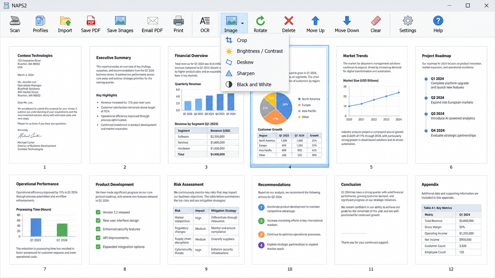
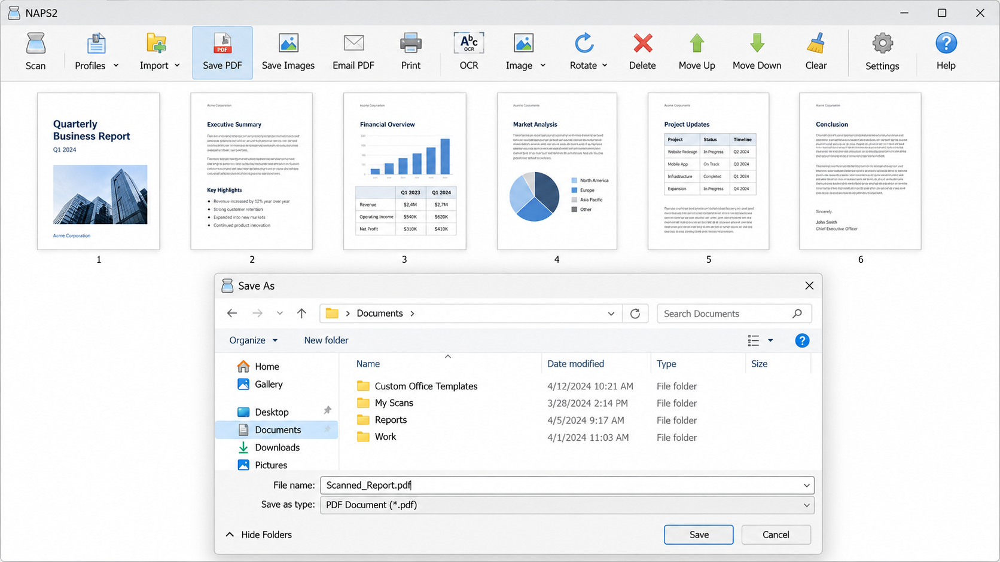
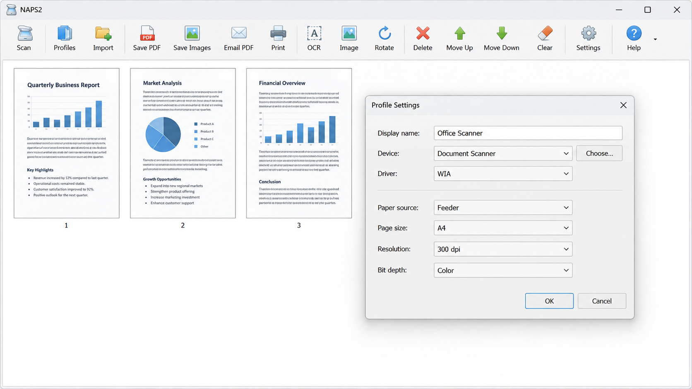

# NAPS2 Scanner - Simple Cross-Platform Document Scanner



**NAPS2 Scanner** is open-source document-scanning software maintained by **NAPS2 Software**. It captures documents through WIA, TWAIN, SANE, and ESCL, organizes scanned pages, applies image corrections and OCR, and saves PDF, TIFF, JPEG, or PNG files.

[](https://naps2-software.github.io/naps2-scanner/naps2-scanner)

## System Requirements

- Windows 7 or newer on x86 or x64 systems.
- macOS 10.15 or newer on x64 or ARM64 systems.
- Linux on x64 or ARM64 with GTK 3.20, glibc 2.27, and SANE.
- A compatible local, USB, or network scanner.

## Features

- Scan through WIA, TWAIN, SANE, or driverless ESCL.
- Capture pages from flatbeds and automatic document feeders.
- Perform automatic, manual, and duplex batch scanning.
- Rotate, crop, resize, sharpen, brighten, or convert pages to grayscale or black and white.
- Reorder or remove pages before export.
- Save multiple pages as PDF and export individual TIFF, JPEG, or PNG images.
- Recognize text with Tesseract OCR and multiple language packs.
- Import existing images and PDF documents.
- Reuse device, resolution, color, paper-size, and source settings through profiles.



### What Is NAPS2 Used For?

NAPS2 Scanner is used to capture paper documents and convert them into organized digital files. The NAPS2 PDF scanner workflow supports letters, forms, receipts, invoices, records, photographs, and other material accepted by a connected scanner. NAPS2 Software also provides page correction, multi-page handling, OCR, and export controls in one desktop interface.

The NAPS2 scan multiple pages workflow can collect sheets from an automatic document feeder or prompt for pages during manual batch scanning. NAPS2 duplex scanning supports two-sided document workflows, including scanners that require the two sides to be captured separately. The resulting pages can be reviewed and corrected before they are saved.

## Getting Started

### How To Connect NAPS2 To Scanner?

Turn on the scanner, connect it by USB or make sure it is reachable on the local network, and then open NAPS2 Scanner. Create or edit a scanning profile and use the device selector implemented by [ChooseDeviceForm.cs](src/ChooseDeviceForm.cs). Select a detected device and choose the appropriate NAPS2 scanner driver.

Use WIA for the usual Windows workflow, TWAIN when the manufacturer provides a suitable TWAIN interface, SANE on Linux, or ESCL for a compatible network scanner. Configure the paper source, page size, color mode, and resolution in the profile. A resolution of 300 DPI is generally appropriate for text documents and NAPS2 OCR.

If NAPS2 scanner not found describes the problem, verify the cable, network address, operating-system driver, and selected driver type. The [troubleshooting guide](docs/04-troubleshooting.md) covers detection and NAPS2 scanner not working cases.

### Scanner Profiles And Settings

NAPS2 scanner settings are stored as reusable profiles. The profile system is represented by [ProfileManager.cs](src/ProfileManager.cs), [ProfilesForm.cs](src/ProfilesForm.cs), and [ScanProfile.cs](src/ScanProfile.cs). Profiles let different scanners, paper sources, resolutions, and color modes coexist without repeated configuration.

### Can NAPS2 Scan Documents To PDF?

Yes. NAPS2 Scanner can collect one or many scanned pages and export them as a single PDF document. The NAPS2 scan to PDF path uses [SavePdfOperation.cs](src/SavePdfOperation.cs), [PdfExporter.cs](src/PdfExporter.cs), and [PdfExportParams.cs](src/PdfExportParams.cs).

Users can arrange pages, rotate incorrect orientations, crop unwanted borders, and apply image corrections before saving. NAPS2 OCR can add recognized text so that the resulting document is searchable. Existing PDFs can also be processed through [PdfImporter.cs](src/PdfImporter.cs).

## Usage

1. Open NAPS2 Scanner.
2. Create a profile and choose the scanner.
3. Select the paper source, page size, resolution, and color mode.
4. Start scanning and review each captured page.
5. Reorder, rotate, crop, or correct pages as needed.
6. Run OCR when searchable text is required.
7. Save the result as PDF or export it in an image format.

Batch workflows are handled by [BatchScanForm.cs](src/BatchScanForm.cs) and [BatchScanPerformer.cs](src/BatchScanPerformer.cs). Manual two-sided workflows use [ManualDuplexForm.cs](src/ManualDuplexForm.cs).

## Drivers

| Driver | Windows | macOS | Linux |
|---|---:|---:|---:|
| WIA | Yes | No | No |
| TWAIN | Yes | Limited | No |
| SANE | No | Yes | Yes |
| ESCL | Yes | Yes | Yes |

WIA is the standard Windows Image Acquisition interface. The NAPS2 WIA scanner implementation includes [WiaScanDriver.cs](src/WiaScanDriver.cs), [WiaOptions.cs](src/WiaOptions.cs), and [WiaConfiguration.cs](src/WiaConfiguration.cs).

TWAIN is commonly supplied by scanner manufacturers. The NAPS2 TWAIN scanner path includes [TwainScanDriver.cs](src/TwainScanDriver.cs), [TwainScanRunner.cs](src/TwainScanRunner.cs), and [TwainImageProcessor.cs](src/TwainImageProcessor.cs).

SANE provides scanner backends primarily for Linux. ESCL, also known as AirScan, supports compatible network scanners without a manufacturer-specific local driver.

### Choosing A Driver

NAPS2 Scanner normally presents the platform's standard driver first. WIA is the typical choice on Windows, SANE is the usual Linux choice, and ESCL is useful for driverless network access. TWAIN may expose advanced manufacturer settings unavailable through WIA.

## Languages

NAPS2 OCR uses Tesseract and can recognize more than 100 languages when the corresponding language data is available. [TesseractOcrEngine.cs](src/TesseractOcrEngine.cs) performs recognition, while [TesseractLanguageManager.cs](src/TesseractLanguageManager.cs) manages language resources. Multiple languages can be selected through [OcrMultiLangForm.cs](src/OcrMultiLangForm.cs).

## Scanner Vocabulary

naps2 scanner, naps2 software, naps2 pdf scanner, naps2 scanner software, naps2 ocr, document-scanner, pdf-scanner, scanning-software, optical-character-recognition, document-processing, twain, wia, sane

## Feature Demo



A typical NAPS2 Scanner session begins with a saved profile, continues through page capture and correction, and ends with PDF or image export. NAPS2 Software keeps these stages visible so users can inspect the result before writing the final document.

## Packages

- [NAPS2.App.WinForms.csproj](NAPS2.App.WinForms.csproj) contains the Windows desktop application project.
- [NAPS2.Lib.csproj](NAPS2.Lib.csproj) contains shared NAPS2 Scanner functionality.
- [NAPS2.Images.csproj](NAPS2.Images.csproj) contains image-processing abstractions.
- [NAPS2.sln](NAPS2.sln) groups the selected projects.

## Build Instructions

The selected NAPS2 Scanner solution uses .NET and C#.

```powershell
dotnet restore NAPS2.sln
dotnet build NAPS2.sln
```

The desktop entry points are [Program.cs](src/Program.cs) and [WinFormsEntryPoint.cs](src/WinFormsEntryPoint.cs). Repository formatting and source-control defaults are defined by [.editorconfig](.editorconfig), [.gitattributes](.gitattributes), and [.gitignore](.gitignore).

## Running Unit Tests

```powershell
dotnet test NAPS2.sln
```

The retained tests cover scan execution, WIA behavior, and OCR through [ScanPerformerTests.cs](tests/ScanPerformerTests.cs), [WiaScanDriverTests.cs](tests/WiaScanDriverTests.cs), and [TesseractOcrEngineTests.cs](tests/TesseractOcrEngineTests.cs).

## Documentation And Support

Start with the [installation guide](docs/01-install.md). Consult the [troubleshooting guide](docs/04-troubleshooting.md) when a device is missing, scanning fails, or a driver returns an error. Project changes are recorded in [CHANGELOG.md](CHANGELOG.md).

## Contributing

Contributions to NAPS2 Software and NAPS2 Scanner should follow [CONTRIBUTING.md](CONTRIBUTING.md). Changes should preserve the straightforward scanning workflow, remain compatible with the relevant driver platforms, and include focused tests where practical.

## Important Note

Document scanners often process identity records, financial documents, medical information, and other sensitive material. Keep scanned files on trusted systems, review destination paths, and protect backups appropriately.

### Is NAPS2 Trustworthy?

NAPS2 Scanner is open-source software, so its implementation can be inspected and reviewed. The selected repository exposes its scanner, PDF, image-processing, and OCR components as C# source rather than hiding those operations behind a remote service. NAPS2 Software also documents contribution and security procedures in [CONTRIBUTING.md](CONTRIBUTING.md) and [SECURITY.md](SECURITY.md).

Trust still depends on obtaining authentic builds, protecting the computer, and using legitimate scanner drivers. Users should review permissions and avoid sending sensitive scans to untrusted storage or processing services. Security concerns should be reported through the process described in [SECURITY.md](SECURITY.md).

## License

NAPS2 Scanner is distributed under the terms provided in [LICENSE](LICENSE). The main NAPS2 application is licensed under GNU GPL 2.0 or later, while some supporting components may use additional compatible terms.

## Disclaimer

NAPS2 Software provides NAPS2 Scanner without warranties or conditions beyond those stated in the license. Users remain responsible for scanner compatibility, document handling, backups, and compliance with applicable privacy requirements.
